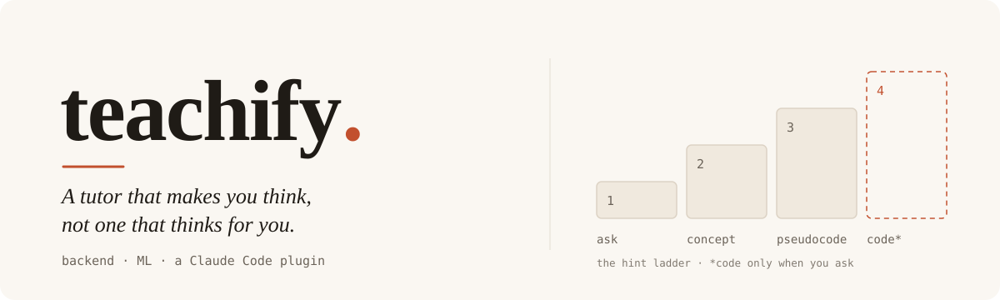
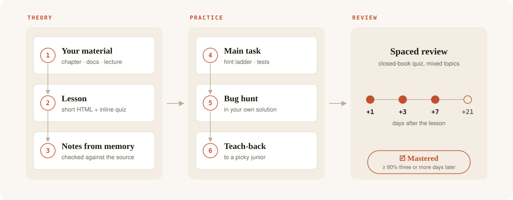
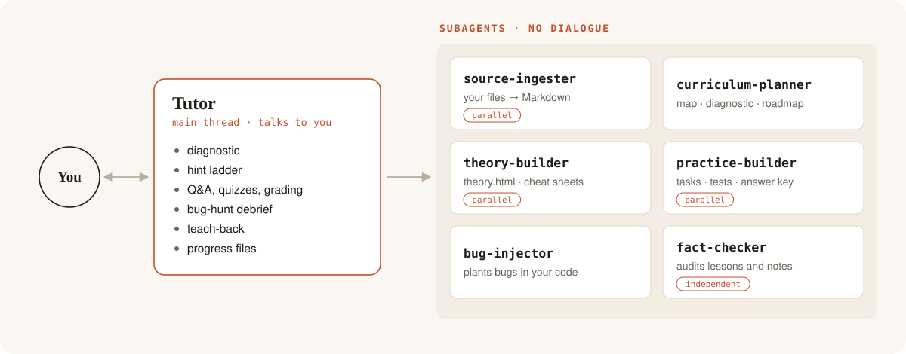

<p align="center">
  <picture>
    <source media="(prefers-color-scheme: dark)" srcset=".github/assets/banner-dark.svg">
    
  </picture>
</p>

<p align="center">
  <a href="#install"></a>
  <a href=".claude-plugin/plugin.json"></a>
  <a href="LICENSE"></a>
  
</p>

<p align="center">
  <b>teachify</b> turns Claude into a guard-railed tutor for <b>backend</b> and <b>machine learning</b>.<br>
  A diagnostic, a roadmap, and lessons built from <i>your</i> materials: theory, hands-on practice, bug hunts, spaced review.
</p>

---

## Why

The same AI can make you learn more or learn less. What decides it is how you use it.

> In a field experiment with ~1,000 students, plain GPT-4 lifted practice scores by **48%** but cut exam scores by **17%** once the AI was taken away. A tutor version that withheld answers and gave step-by-step hints lifted practice by **127%** and avoided most of that loss.
> <sub>Bastani et al., PNAS 2025</sub>

In Anthropic's own study, developers who learned a new library by delegating to AI scored 50% on the follow-up quiz, against 67% for those who wrote the code themselves. Debugging took the biggest hit. teachify is built on the other side of that line: **you do the thinking, Claude does the tutoring.**

## Install

### From the marketplace (recommended)

In Claude Code, run:

```
/plugin install teachify --marketplace SquareDealer/teachify
```

That's it. On Claude Code versions before 2.1.275, add the marketplace first, then install:

```
/plugin marketplace add SquareDealer/teachify
/plugin install teachify@squaredealer
```

Same thing from a terminal:

```bash
claude plugin marketplace add SquareDealer/teachify
claude plugin install teachify@squaredealer
```

**Update** when a new version is out:

```
/plugin marketplace update squaredealer
```

> [!NOTE]
> Plugin skills are namespaced, so the command is **`/teachify:teachify`**. Prefer a plain `/teachify`? Use the manual install below.

<details>
<summary><b>Manual install</b> (plain <code>/teachify</code> command)</summary>

```bash
git clone https://github.com/SquareDealer/teachify.git
mkdir -p ~/.claude/skills
cp -r teachify/skills/teachify ~/.claude/skills/
```

For a single project, copy it to `.claude/skills/teachify/` inside that repo instead.

</details>

<details>
<summary><b>Claude apps</b> (claude.ai, desktop)</summary>

Upload [`skills/teachify/SKILL.md`](skills/teachify/SKILL.md) as a custom skill in Settings.

</details>

## Quick start

```bash
mkdir ml-course && cd ml-course
```

```
/teachify:teachify init machine learning
```

Claude asks why you're learning, runs a 20–30 minute adaptive diagnostic, asks what level you're aiming for, and writes `roadmap.md`. From then on, each session is one command:

```
/teachify:teachify ./roadmap.md
```

## Commands

| Command | What happens |
|:--|:--|
| `init [topic]` | Mission interview → adaptive diagnostic → target level → `roadmap.md` |
| `path/to/roadmap.md` | Reviews that are due → next lesson: asks for your material, builds theory + practice, tutors you through it |
| `learn <concept>` | One-off lesson on a single concept, no roadmap. Starts with a quick prerequisite check |
| `review` | Spaced, interleaved quiz over everything you've learned so far |

## How a lesson works

<p align="center">
  <picture>
    <source media="(prefers-color-scheme: dark)" srcset=".github/assets/lesson-loop-dark.svg">
    
  </picture>
</p>

1. **Your material is the source of truth.** Drop in a chapter, a docs page or a lecture. It's converted to Markdown, and every claim in the lesson cites it. Nothing is taught from the model's memory alone.
2. **Theory** is a short, printable HTML lesson with an inline quiz. Then you close it and write `notes.md` **from memory**. A separate agent checks your notes against the source and lists what's wrong or missing. It never rewrites them for you.
3. **Practice** is a fixed four-step loop, about 45–60 minutes:
   - **Main task.** ML: implement from scratch in NumPy, then check against PyTorch/sklearn with a gradient check. Backend: write the core of a service inside a ready scaffold, at `TODO(human)` markers.
   - **Bug hunt.** Realistic bugs are planted in *your* passing solution: data leakage, a wrong axis, a race condition, N+1 queries. You find them from the symptom alone.
   - **Teach-back.** You explain the topic in two minutes. Claude keeps asking "why?" until it finds the weak spot.
   - **Retrieval seeds.** Three questions go into your review schedule.
4. **Progress lives in `roadmap.md`** as checkboxes: **Theory**, **Practice**, and **Mastered**. Mastered is ticked only after you score at least 80% on a quiz taken three or more days later.

## The tutor contract

Claude never jumps to the answer. When you're stuck, it climbs the **hint ladder** one rung at a time:

| Rung | Claude gives you |
|:--:|:--|
| 1 | A guiding question |
| 2 | The concept you need, with a link to the exact theory section |
| 3 | Pseudocode |
| 4 | Code, **only when you explicitly ask**. The task is then marked `assisted` and doesn't count toward mastery |

The rest of the contract: you attempt or guess first, debugging stays in your hands, "it's all clear" gets answered with a closed-book recall check, and boilerplate around things you've already mastered can be generated, as long as you can explain it.

## Architecture

Anything that needs a conversation with you stays in the main thread. Heavy reading, generation and independent checks go to subagents, which keeps the tutor's context clean and stops it from grading its own work.

<p align="center">
  <picture>
    <source media="(prefers-color-scheme: dark)" srcset=".github/assets/architecture-dark.svg">
    
  </picture>
</p>

| Subagent | Runs | Job |
|:--|:--|:--|
| **source-ingester** | each source, in parallel | Clean, faithful Markdown with LaTeX formulas and an index of headings |
| **curriculum-planner** | `init`, and when you have no source | Concept map, a 3-tier diagnostic with a rubric, the roadmap, primary sources |
| **theory-builder** | each lesson, in parallel with practice | The lesson page, cited and anchored, plus cheat sheets |
| **practice-builder** | each lesson, in parallel with theory | Tasks, tests and scaffolds, plus an answer key with pre-written hints. Checks that the tests fail on the starter code and pass on the reference solution |
| **bug-injector** | after your main task passes | 1–3 bugs with observable symptoms, at least one that the visible tests miss |
| **fact-checker** | after the build and after your notes | Every finding comes with a quote from the source. Never the agent that wrote the lesson |

## Your course folder

One folder per course, all plain files that you own and can commit:

```
ml-course/
├── MISSION.md          why you're learning, target level, constraints
├── PROFILE.md          diagnostic results, strengths, weak spots
├── roadmap.md          modules → lessons → ☐ Theory ☐ Practice ☐ Mastered
├── RESOURCES.md        vetted sources and communities
├── GLOSSARY.md         terms you can already use correctly
├── errors.md           misconception log, the main input for reviews
├── reviews.md          spaced-repetition schedule
├── learning-records/   what you've proven you know
├── reference/          printable cheat sheets
└── lessons/0001-softmax-ce/
    ├── sources/        your material as Markdown
    ├── theory.html
    ├── notes.md        written by you
    ├── practice/       tasks, tests, bug hunt
    └── .keys/          answer key and solutions (don't peek)
```

## Research basis

| Study | Takeaway built into teachify |
|:--|:--|
| [Bastani et al., PNAS 2025](https://ideas.repec.org/a/nas/journl/v122y2025pe2422633122.html) | A guard-railed tutor with a solution key helps; open-ended AI help hurts retention |
| [Kestin et al., Scientific Reports 2025](https://pmc.ncbi.nlm.nih.gov/articles/PMC12179260/) | A tutor grounded in prepared notes more than doubled learning gains over an active-learning class |
| [Shen & Tamkin, Anthropic 2026](https://www.anthropic.com/research/AI-assistance-coding-skills) | Delegating code to AI hurts skill formation, and debugging suffers most → bug hunts |
| [Lee et al., CHI 2025](https://www.microsoft.com/en-us/research/?p=1135061) | The more you trust AI, the less you check it → an independent fact-checker |
| [Dunlosky et al., 2013](https://www.psychologicalscience.org/news/releases/which-study-strategies-make-the-grade.html) | Retrieval practice and spacing beat rereading → recall notes and spaced reviews |

## Credits

The theory block, workspace and file formats are adapted from Matt Pocock's [`teach`](https://github.com/mattpocock/skills) skill (MIT).

<details>
<summary><b>For maintainers</b></summary>

`version` is pinned in [`.claude-plugin/plugin.json`](.claude-plugin/plugin.json). Bump it on every release, or installed copies won't update. Validate before pushing:

```bash
claude plugin validate --strict .
```

README diagrams are generated: edit and run `python3 .github/assets/make_diagrams.py`.

</details>

## License

[MIT](LICENSE) © Ivan Nikiforov
